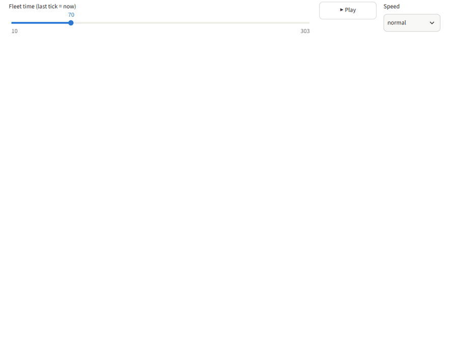
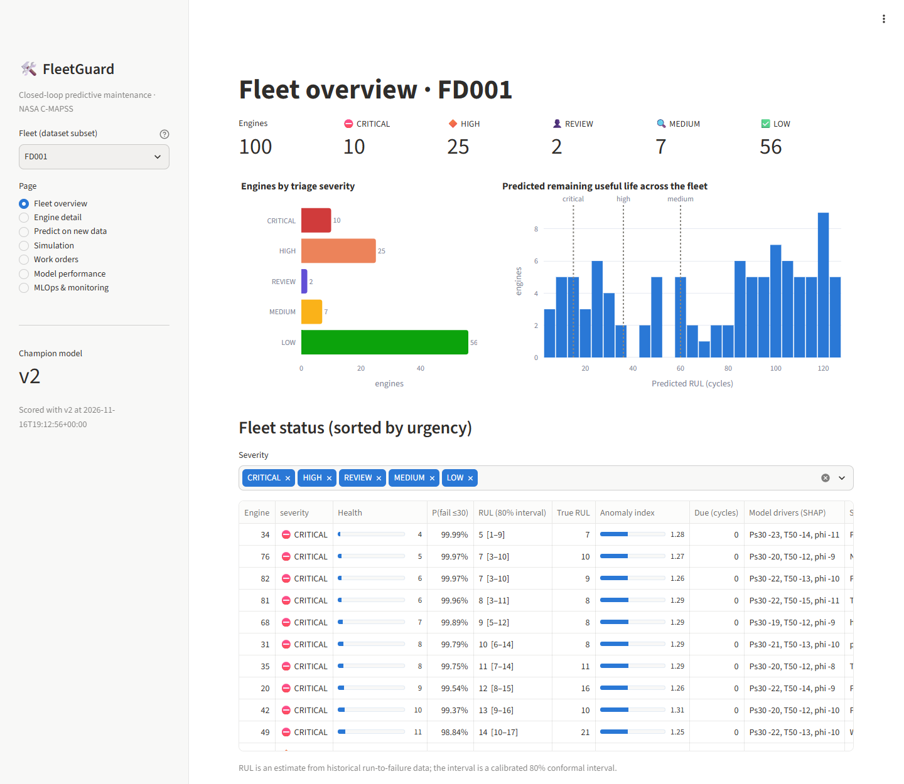
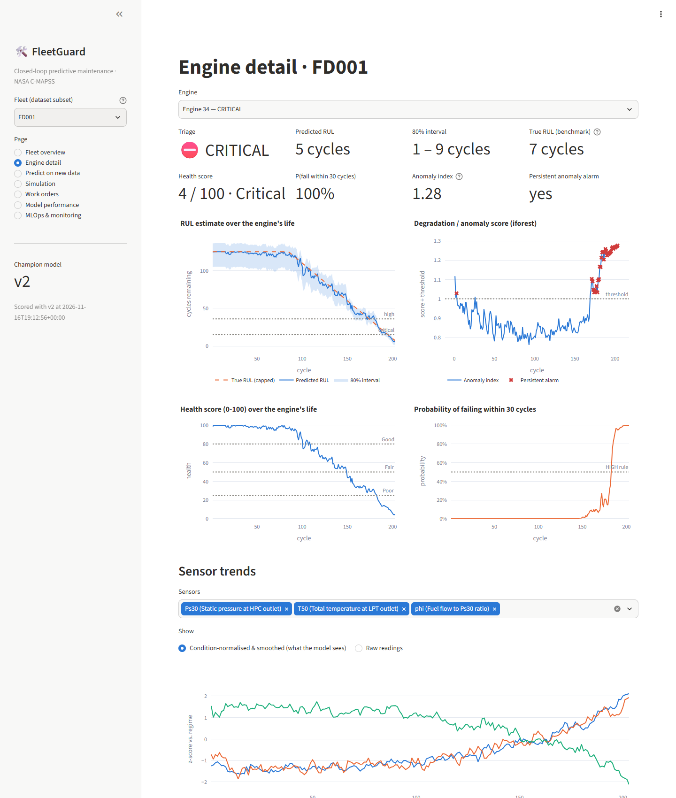
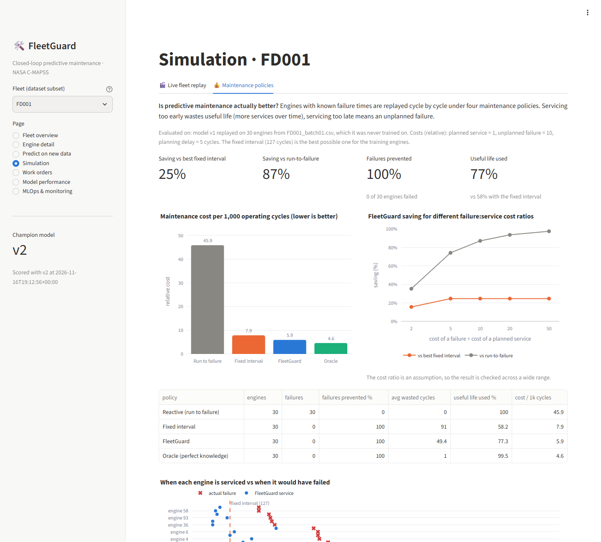
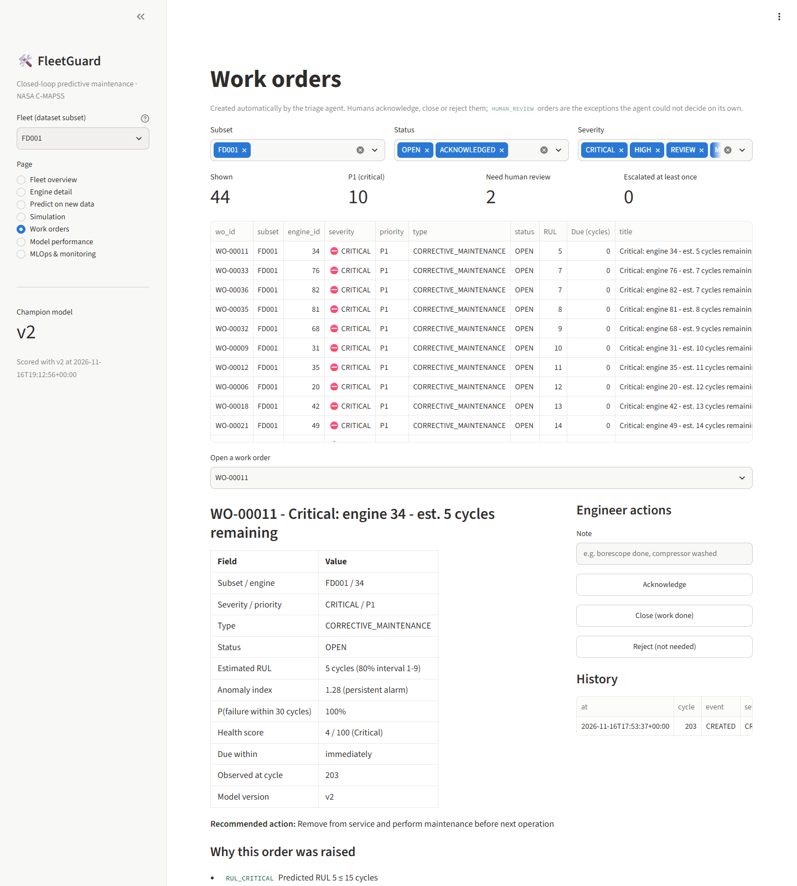
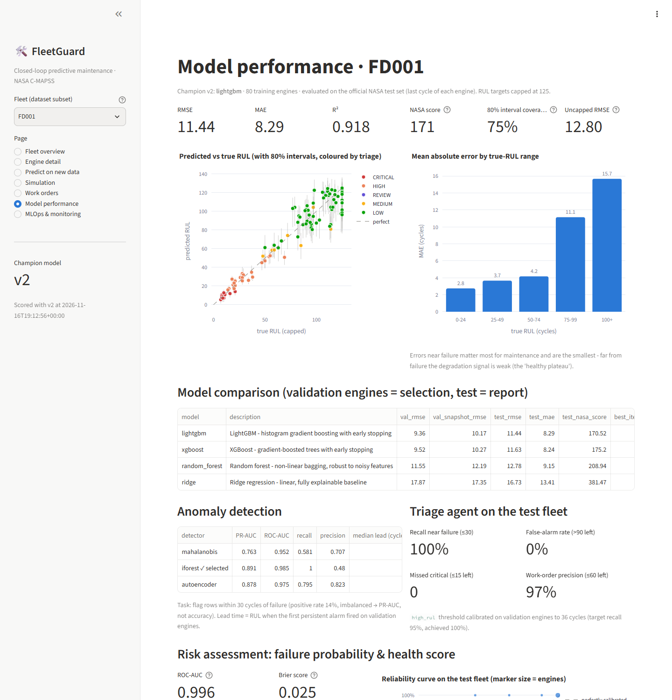
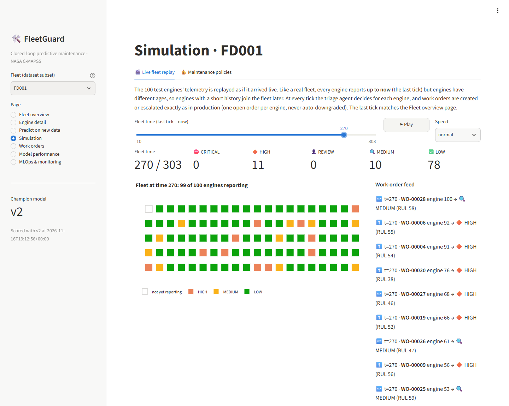
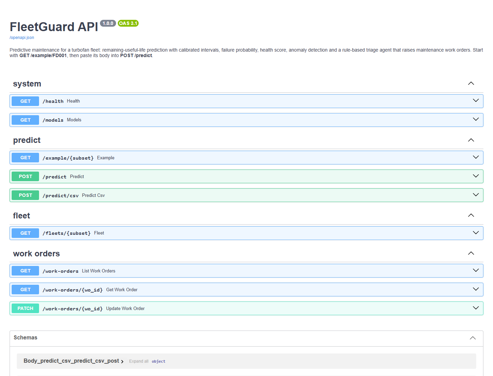
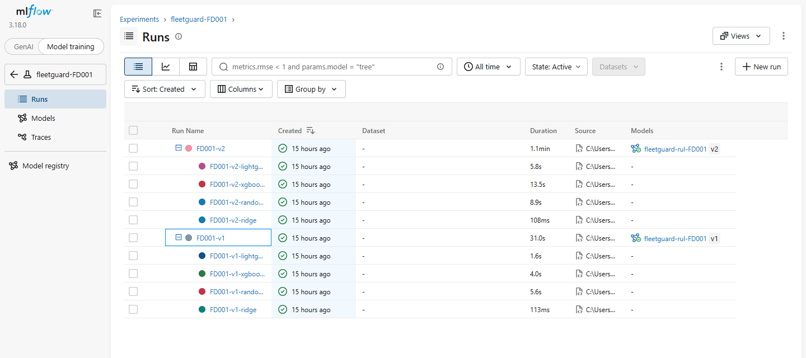

# FleetGuard: closed-loop predictive maintenance

[](https://drive.google.com/file/d/1_pbWPsYn9Hj-I9DSARySG2GQv0NJ9l78/view?usp=sharing)

FleetGuard reads engine sensor telemetry, cleans it, and detects early
degradation. It predicts each engine's **Remaining Useful Life (RUL)** with a
calibrated uncertainty interval, and a **rule-based triage agent** then raises,
escalates or routes **maintenance work orders**. Experiments, model versions,
drift and retraining are managed with **MLflow** and a champion/challenger
registry, and a **Streamlit** dashboard covers monitoring and the human
decisions.

The system runs end to end on all four subsets of the NASA C-MAPSS turbofan
dataset (FD001-FD004) with a single command.

```
sensor data ─► validate & repair ─► regime normalisation ─► rolling features
           ─► RUL model + conformal interval ─┐
           ─► anomaly detector ───────────────┴─► triage agent ─► work order ─► dashboard / engineer
                      ▲                                                          │
                      └──── MLflow · registry · drift (PSI) · retraining ◄───────┘ new run-to-failure data
```



*Live fleet replay: every engine reports up to "now"; tiles turn from healthy green to high/critical as engines
degrade, and the work-order feed shows the agent creating and escalating orders. **[Watch the full demo video on Google Drive](https://drive.google.com/file/d/1_pbWPsYn9Hj-I9DSARySG2GQv0NJ9l78/view?usp=sharing)**.*

## Results

Official NASA test sets (last observed cycle of every test engine, true RUL capped at 125 like the target).
Champion model after the retraining demo:

| Subset | Model | RMSE | MAE | R² | NASA score | Uncapped RMSE | 80% interval coverage | Anomaly PR-AUC | Agent recall | False alarms | Missed critical |
|---|---|---|---|---|---|---|---|---|---|---|---|
| FD001 | lightgbm | **11.44** | 8.29 | 0.918 | 171 | 12.80 | 75% | 0.89 (iforest) | 100% | 0% | 0 |
| FD002 | xgboost | **11.15** | 7.77 | 0.933 | 531 | 24.04 | 80% | 0.87 (iforest) | 98% | 0% | 0 |
| FD003 | xgboost | **10.24** | 6.71 | 0.932 | 218 | 12.09 | 80% | 0.74 (mahalanobis) | 100% | 0% | 0 |
| FD004 | xgboost | **11.63** | 7.54 | 0.927 | 652 | 24.83 | 79% | 0.77 (mahalanobis) | 100% | 1% | 0 |

**How to read the two RMSE columns.** The model is trained on RUL capped at 125 cycles, because early in an
engine's life there is no degradation signal to learn from. *RMSE* compares predictions with the true RUL capped
the same way, which is the error that matters for maintenance decisions. *Uncapped RMSE* compares with the raw true
RUL. On FD002/FD004 many test engines have 150-190 cycles left, and a capped model cannot (and need not) tell those
apart, so that column is larger. It is the one to use when comparing with papers that do not cap the test labels.

**Risk assessment** (test fleet, last cycle of each engine):

| Subset | P(fail ≤30) ROC-AUC | Brier score | Calibration error (ECE) | Health score ↔ true RUL (Spearman ρ) |
|---|---|---|---|---|
| FD001 | 0.996 | 0.025 | 0.032 | 0.91 |
| FD002 | 1.000 | 0.009 | 0.025 | 0.94 |
| FD003 | 1.000 | 0.013 | 0.043 | 0.94 |
| FD004 | 0.994 | 0.026 | 0.033 | 0.93 |

**Maintenance-policy simulation** (engines the model never saw; cost per 1,000 operating cycles, failure = 10× a planned service):

| Subset | Engines | Reactive | Best fixed interval | **FleetGuard** | Oracle | Failures with FleetGuard | Saving vs fixed | Useful life used (FleetGuard vs fixed) |
|---|---|---|---|---|---|---|---|---|
| FD001 | 30 | 45.9 | 7.9 (every 127) | **5.9** | 4.6 | 0 | **25%** | 77% vs 58% |
| FD002 | 78 | 48.5 | 8.7 (every 128) | **6.1** | 4.9 | 0 | **30%** | 79% vs 62% |
| FD003 | 30 | 37.0 | 6.9 (every 144) | **4.6** | 3.7 | 0 | **34%** | 80% vs 53% |
| FD004 | 75 | 43.0 | 8.6 (every 130) | **5.5** | 4.3 | 0 | **36%** | 78% vs 56% |

The fixed interval is the *best possible* one for the engines the model was trained on, and FleetGuard still beats it at every failure-cost ratio tested (2× to 50×). The costs are assumptions and C-MAPSS is simulated, so these are relative, not real, savings.

* **RMSE / MAE** in cycles. **NASA score** is the PHM08 asymmetric score (late predictions cost more; lower is better).
* **Coverage** is the share of test engines whose true RUL falls inside the 80% conformal interval.
* **Agent recall** is the share of engines truly ≤ 30 cycles from failure that got a work order or human review. **False alarms** is the share of engines with > 90 cycles left that got a maintenance order. **Missed** is the number of engines ≤ 15 cycles from failure left without action.

## Highlights

* **One pipeline for all four subsets.** KMeans recovers the 6 flight regimes in FD002/FD004, and each sensor is z-scored per regime so the wear trend becomes visible.
* **Robust data engineering.** Duplicates, out-of-order messages, gaps and spikes are repaired and counted, and tests prove recovery from a deliberately corrupted feed. All features are **strictly causal**, so one code path serves batch scoring, streaming and the per-cycle RUL trajectory (this is unit-tested).
* **Model selection with MLflow.** Ridge, Random Forest, XGBoost and LightGBM are compared, each as a nested MLflow run, using engine-level validation with no leakage. Mild **imbalance re-weighting** gives more weight to the rare near-failure rows.
* **Uncertainty.** Mondrian split-conformal intervals, with coverage verified on the test set.
* **Risk assessment.** A calibrated **probability of failure within 30 cycles** (logistic model on RUL + anomaly signal, checked with a reliability curve, Brier score and ROC-AUC) and a transparent **0-100 health score** with Good/Fair/Poor/Critical bands, both shown on the dashboard and in every work order.
* **Three anomaly detectors** (Mahalanobis, Isolation Forest, and a neural-network autoencoder), trained only on healthy data. Their thresholds are set from healthy validation engines, alarms require persistence, and the detectors are compared by PR-AUC and lead time.
* **SHAP explanations in every work order.** The 3 sensors that pulled the predicted RUL down, in cycles (e.g. "phi −9 cycles"), shown next to the sensor-deviation evidence.
* **SQLite storage.** Work orders with their full history, and every scoring run with each engine's prediction, queryable with SQL; the dashboard and pipeline write safely side by side.
* **Maintenance-policy simulation.** On engines the model never saw, FleetGuard prevented every failure and cost 25-36% less than the best fixed service interval, using about 78% of each engine's life instead of about 57%.
* **Live fleet replay.** A dashboard page plays the fleet forward in time: engine tiles change colour and a work-order feed shows orders being created and escalated.
* **Triage agent with no LLM.** Ordered rules with reason codes. The *high* threshold is **calibrated** on validation data to reach 95% recall, the agent is uncertainty-aware (it uses the interval's lower bound), and it sends exceptions (bad data, disagreeing models, huge uncertainty) to humans.
* **Work-order lifecycle.** One open order per engine, which is updated or escalated in place and never auto-downgraded. Only humans close or reject orders, and every order keeps a full history.
* **MLOps loop.** New data in `data/incoming/` triggers a drift check (PSI), a challenger is trained and compared with the champion, then promoted or rejected. MLflow Model Registry aliases and a local versioned registry keep track of versions.
* **Predict on new data.** Upload engine histories (CSV or NASA .txt), add a new sensor reading to an engine and watch the prediction update, or use a what-if simulator that drifts sensors and shows how the RUL and the agent react.
* **REST API + Docker.** A FastAPI service (`/predict`, `/predict/csv`, work-order endpoints, auto-generated docs) and a docker-compose stack that starts the API, dashboard and MLflow with one command.
* **A 76-test pytest suite** covering data, features, models, agent rules, work orders, the REST API, new-data inference, and an end-to-end integration run.

## Quick start

```bash
python -m venv venv
venv\Scripts\activate             # Windows  (source venv/bin/activate on Linux/macOS)
pip install -r requirements.txt
pip install -e .

python -m fleetguard run-all      # all four subsets, ~15-20 min on a laptop
# python -m fleetguard run-all --subsets FD001     # one subset, ~3 min

streamlit run dashboard/app.py                                  # dashboard
mlflow ui --backend-store-uri sqlite:///mlruns/mlflow.db        # experiment tracking -> http://127.0.0.1:5000
pytest                                                          # tests
```

On Windows, `.\scripts\run_demo.ps1` runs the pipeline and opens the dashboard.

The NASA C-MAPSS files are expected in `data/raw/CMAPSSData/` (from
[data.nasa.gov](https://data.nasa.gov/dataset/cmapss-jet-engine-simulated-data)).

## Run with Docker

One command starts the REST API, the dashboard and MLflow:

```bash
docker compose up --build -d
```

| Service | URL |
|---|---|
| REST API (interactive docs) | http://localhost:8000/docs |
| Dashboard | http://localhost:8501 |
| MLflow | http://localhost:5000 |

The containers use the models, outputs and MLflow history in your project folder (mounted as volumes).
On a fresh clone with no trained models, train inside Docker first (~20 min):

```bash
docker compose --profile train run --rm pipeline
```

`docker compose down` stops everything. The image pins the exact library versions the models were trained with,
so a model bundle saved on the host loads identically in the container.

## REST API

`fleetguard serve` (or the `api` container) exposes the system over HTTP. Docs are generated automatically at `/docs`.

| Method | Endpoint | Purpose |
|---|---|---|
| GET | `/health`, `/models` | status, champion model per subset with test metrics |
| GET | `/example/{subset}` | a real engine's history, ready to send to `/predict` |
| POST | `/predict` | sensor history (JSON) → RUL + 80% interval, health score, failure probability, severity, reasons, SHAP drivers; optional work order |
| POST | `/predict/csv` | the same for an uploaded CSV or NASA `.txt` file |
| GET | `/fleets/{subset}` | latest scored state of a benchmark fleet |
| GET / PATCH | `/work-orders`, `/work-orders/{id}` | list orders; acknowledge, close or reject them |

```bash
curl "http://localhost:8000/example/FD004?engine_id=25&last_cycles=600" -o body.json
curl -X POST http://localhost:8000/predict -H "Content-Type: application/json" --data @body.json
```

The model is chosen automatically from the data (operating regimes), e.g. `"selection_reason": "6 operating regimes
detected -> multi-regime model (FD004)"`. A warm request with a 486-cycle history takes about 0.2 s, SHAP included.

### What `run-all` does for every subset

1. **Train v1** on 70% of the training engines and register it as champion.
2. **New data arrives**: the remaining 30% of engines are written to `data/incoming/` as a new batch.
3. **Retrain**: drift check of the batch, train v2 on all engines, compare it with v1, then promote or reject.
4. **Score the fleet** (the official test engines). The agent decides for each engine and work orders are stored in a SQLite database (`outputs/fleetguard.db`) and also written as Markdown files, and the scoring run with every engine's prediction is recorded.
5. **Streaming replay**: the test fleet is replayed cycle by cycle, and work orders appear and escalate over time.
6. **Policy simulation**: v1 is replayed on the batch it never saw, comparing run-to-failure, the best fixed interval, FleetGuard and a perfect-knowledge oracle on maintenance cost.

### Individual commands

```bash
python -m fleetguard train   --subset FD002 [--initial-fraction 0.7]
python -m fleetguard simulate-arrival --subset FD002
python -m fleetguard retrain --subset FD002          # skipped if data/incoming is empty
python -m fleetguard score   --subset FD002
python -m fleetguard stream  --subset FD002 --step 5
python -m fleetguard simulate-policies --subset FD002
python -m fleetguard work-orders --status OPEN
python -m fleetguard close WO-00012 --note "HPC washed, borescope OK"
python -m fleetguard serve --port 8000            # REST API, docs at /docs
# options: --no-mlflow, --fast (tiny models), --models xgboost lightgbm
```

## Example work order (generated)

### WO-00001 - High priority: engine 3 - est. 51 cycles remaining

| Field | Value |
|---|---|
| Subset / engine | FD001 / 3 |
| Severity / priority | HIGH / P2 |
| Type | SCHEDULED_MAINTENANCE |
| Status | OPEN |
| Estimated RUL | 51 cycles (80% interval 43-58) |
| Anomaly index | 1.18 (persistent alarm) |
| Due within | 37 cycles |
| Observed at cycle | 126 |
| Model version | v2 |

**Recommended action:** Schedule maintenance within the due window

#### Why this order was raised
- `ANOMALY_AND_RUL` Persistent anomaly with RUL 51 <= 60

#### Primary indicators
| Sensor | Meaning | Component | Deviation |
|---|---|---|---|
| phi (sensor_12) | Fuel flow to Ps30 ratio | Combustor / fuel system | -2.7 SD, falling |
| htBleed (sensor_17) | Bleed enthalpy | Bleed system | +2.4 SD, rising |
| T50 (sensor_4) | Total temperature at LPT outlet | Low-pressure turbine | +2.3 SD, rising |

#### Suggested checks
- Inspect fuel nozzles and fuel-metering unit
- Check bleed valves and bleed-air ducting
- Borescope the LPT; review exhaust-gas temperature margin

> RUL is a statistical estimate from historical run-to-failure data, not a guarantee.
> Suggested checks are a heuristic mapping from sensor location to component.

## Dashboard

| Page | Shows |
|---|---|
| Fleet overview | severity counts, RUL distribution against the agent thresholds, sortable fleet table with intervals, anomaly index and fired rules, and a re-score button |
| Engine detail | RUL trajectory with 80% band against the true RUL, anomaly score with alarms, raw vs regime-normalised sensor trends, the agent's decision and work order, and SHAP contributions per sensor |
| Predict on new data | **Model chosen automatically** (counts operating regimes: 1 → FD003/FD001 model, several → FD004/FD002; NASA engines use their own fleet's model; manual override with a mismatch warning) · **Upload** engine histories → predictions, data-quality report, CSV download, optional work orders · **Add a reading**: enter the next cycle's sensor values for an engine and see RUL and triage update · **What-if simulator**: drift sensors (in SDs, with presets such as HPC or fan degradation) and compare the scenario with the original |
| Simulation | **Live fleet replay** (play button and time slider: engine tiles change colour, live work-order feed, severity counts over time) · **Maintenance policies** (cost of reactive vs best fixed interval vs FleetGuard vs oracle, savings across cost ratios, when each engine is serviced vs when it would have failed) |
| Work orders | filter, open, acknowledge, close or reject with notes (human in the loop), with full history |
| Model performance | test metrics, predicted vs true scatter with intervals coloured by severity, error by RUL range, model comparison, anomaly-detector comparison, agent metrics, feature importance |
| MLOps & monitoring | registry versions and promotion decisions, RMSE by version, drift on new data and on the live fleet (PSI), data quality, streaming timeline, a retrain button |

### Screenshots

| | |
|---|---|
| **Fleet overview:** severity counts, RUL distribution, fleet table with health, P(fail) and SHAP drivers | **Engine detail:** RUL with 80% band vs truth, anomaly score, health score, failure probability, sensor trends |
|  |  |
| **Maintenance policies:** FleetGuard vs run-to-failure vs best fixed interval vs oracle | **Work order:** generated by the agent, with reasons, SHAP drivers and engineer actions |
|  |  |
| **Model performance:** test metrics, predicted vs true, error by RUL range, model comparison | **Live fleet replay** at a later moment, with the work-order feed |
|  |  |
| **REST API:** auto-generated interactive docs (FastAPI) | **MLflow:** each model version with its four candidate models and registered versions |
|  |  |

## Project layout

```
FleetGuard/
├── .github/workflows/ci.yml     tests + pipeline smoke test on every push
├── configs/config.yaml          every threshold and hyper-parameter
├── data/                        NASA C-MAPSS raw files (see data/README.md); incoming/ for new batches
├── dashboard/                   Streamlit dashboard (app.py, predict_page.py, simulation_page.py)
├── docs/                        DESIGN.md (design decisions) and images/ (screenshots)
├── notebooks/                   exploratory analysis built on the package
├── scripts/run_demo.ps1         one-shot demo on Windows
├── src/fleetguard/              the package (below)
├── tests/                       pytest suite
├── Dockerfile · docker-compose.yml · requirements-docker.txt (pinned)
├── pyproject.toml · requirements.txt · LICENSE
│
│   generated at runtime (git-ignored):
├── models/                      versioned model bundles + registry.json per subset
├── outputs/                     fleet scores, work orders, evaluation, monitoring
└── mlruns/                      MLflow tracking store (mlflow.db + artifacts)
```

```
src/fleetguard/
  data/loader.py             C-MAPSS reader, RUL labels, sensor meanings
  data/cleaning.py           validation, repair, fault injection
  data/features.py           regimes, normalisation, causal rolling features
  models/rul.py              candidate models, imbalance weights, conformal intervals
  models/anomaly.py          Mahalanobis + Isolation Forest + autoencoder, persistence, lead time
  models/metrics.py          RMSE/MAE/NASA score, PR-AUC, agent metrics
  agent/triage.py            rule-based triage agent + threshold calibration
  agent/work_orders.py       work-order store, dedup/escalation, Markdown rendering
  mlops/tracking.py          MLflow wrapper (runs, models, registry alias)
  mlops/registry.py          local champion/challenger registry
  mlops/drift.py             Population Stability Index
  training.py                builds one versioned bundle per subset
  scoring.py                 fleet scoring -> agent -> work orders
  explain.py                 SHAP explanations summarised per sensor
  storage.py                 SQLite: work orders, their history, scoring runs, predictions
  simulation.py              maintenance-policy simulation (reactive / fixed / FleetGuard / oracle)
  inference.py               new data: uploads, single new readings, what-if scenarios
  api.py                     FastAPI REST service
  pipeline.py                train / retrain / score / stream / run-all
  cli.py                     command line
```

**[notebooks/01_exploratory_analysis.ipynb](notebooks/01_exploratory_analysis.ipynb)** walks through the data,
explains why the pipeline needs regime normalisation, a capped target and trend features, and shows the final
results.

Design decisions, trade-offs and limitations are in **[docs/DESIGN.md](docs/DESIGN.md)**.

## Tech stack

Python · pandas · NumPy · scikit-learn · XGBoost · LightGBM · SHAP · MLflow · FastAPI · Docker · SQLite · Streamlit · Plotly · pytest · GitHub Actions

## License

MIT, see [LICENSE](LICENSE).
